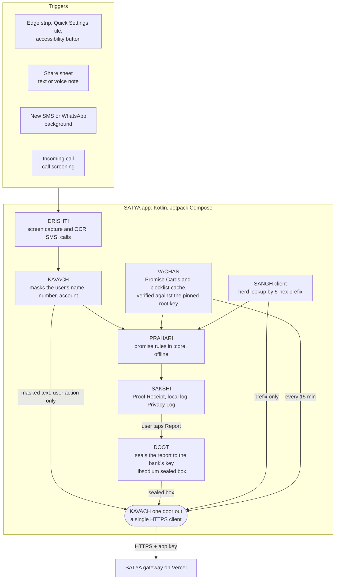
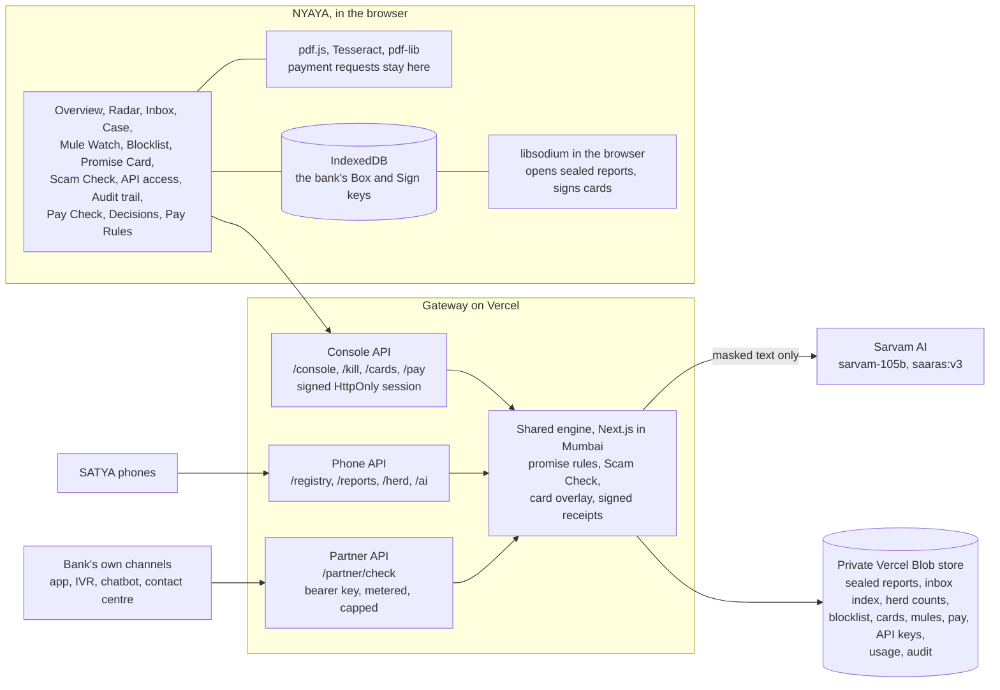
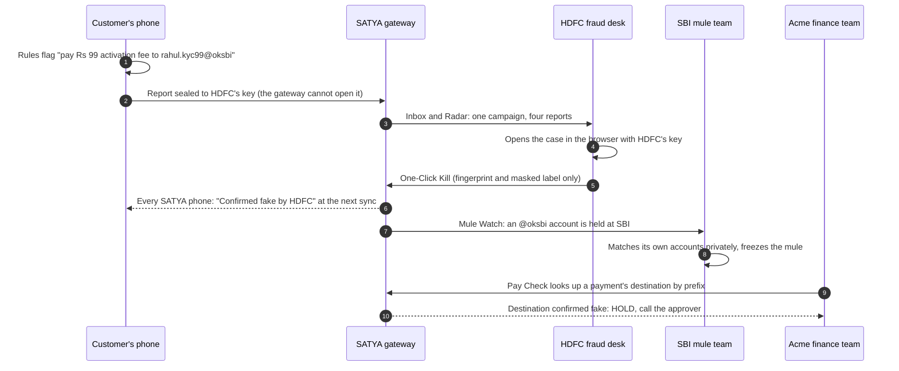

<div align="center">

# SATYA

**Check what a message asks for against what your bank has promised it will never ask for.**

An open-source shield against impersonation and deepfake fraud in Indian banking, built for the RAKSHAM AI Cybersecurity Hackathon (IIT Delhi), Problem Statement 03.

[](LICENSE)
[](android/)
[](android/)
[](web/)
[](https://docs.sarvam.ai)
[](CHANGELOG.md)

[Two products](#two-products) · [Why institutions pay](#why-institutions-pay) · [Architecture](#system-architecture) · [Quick start](#quick-start) · [Testing](#testing) · [Privacy](#privacy-and-the-five-laws) · [Repository map](#repository-map)

</div>

---

## The problem

A scammer can fake a voice, a face, a logo or a sender name. What they cannot change is the request itself:
- *share your OTP*;
- *install AnyDesk*;
- *move your money to a safe account*;
- *pay a ₹10 KYC fee to this UPI ID*.

Banks, the RBI, TRAI and NPCI have already written down that they never ask for these things.

SATYA turns those written statements into signed **Promise Cards** and checks every request against them, on the phone, before money moves.
- AI explains what SATYA sees, in plain English and Hindi.
- A deepfake score is a supporting signal, never the verdict.

> **Transaction monitoring sees the payment. SATYA sees the persuasion, before the payment.**

## Two products

| | **SATYA**, for people | **NYAYA**, for institutions |
|---|---|---|
| Who | Anyone with an Android phone. No account, no login. | Bank fraud desks, and company finance teams. |
| Where | [`android/`](android/) | [`web/`](web/), live at **[satya-gateway.vercel.app/login](https://satya-gateway.vercel.app/login)** |
| What it does | Checks a screen, SMS, call, WhatsApp message or voice note against the bank's promises. Shows a Proof Receipt, and sends a sealed report to the bank. | Turns customer reports into campaigns, blocks, and mule-account alerts. Checks payment requests before money moves. |
| Price | Free | Free tier, then paid licences and a metered API ([business case](docs/INSTITUTIONS.md)) |
| Runs on | The phone. Rules work offline. | The Vercel gateway, with private Blob storage and Sarvam AI. |

### SATYA (the app)

- **Circle to Check.** Freeze any screen and circle the message. Start it from any app by triple-tapping the edge strip, tapping the *Check screen* Quick Settings tile, or using Android's accessibility button.
- **Proof Receipt.** Shows the verdict (*Breaks promise*, *Looks like a scam*, *Keeps promise* or *Unknown*) and the exact promise broken, with a link to its official source. It also shows:
  - the kill-chain stage;
  - the herd count;
  - the SATYA AI reading, in English and Hindi.
- **Background guard.** New SMS and WhatsApp messages and incoming calls are checked against the rules on the phone. Nothing is uploaded.
- **Report to bank.** The report is sealed on the phone with the bank's public key; only that bank can open it. The phone tracks its status, from Delivered to Blocked for everyone.
- **Know Your App.** Flags sideloaded apps that pose as a bank or KYC app, and guards their PIN and OTP screens.
- **Doctor.** Nineteen self-tests, with a 10-run reliability mode.

### NYAYA (for institutions)

The ten features, in the order a fraud desk works:

| | Feature | What it does |
|---|---|---|
| **Detect** | **Fraud Overview** | Reports, median time to act, values blocked and customers warned, with an estimate of the loss avoided. The case register exports as CSV. |
| | **Impersonation Radar** | Groups reports into campaigns by the scammer's UPI IDs, numbers, sites and apps. |
| | **Report Inbox and Case Review** | Sealed reports open in the bank's browser with its own key. An optional AI case brief from Sarvam. |
| **Respond** | **One-Click Kill** | Blocks a confirmed fake on every SATYA phone at the next sync, and closes the matching reports. |
| | **Mule Watch** | Routes accounts confirmed fake by *any* bank to the bank that holds them. The bank can match its own accounts privately, in the browser. |
| **Prevent** | **Promise Card Builder** | The bank edits its official channels, signs them in the browser, and publishes them to every phone. Free tier. |
| | **Scam Check copilot and API** | The same check for contact-centre agents, and as a metered API for the bank's own app, IVR and chatbot. |
| **Govern** | **Named analysts and audit trail** | Every sign-in, block, publication and decision is recorded, with who and when. |
| **Companies** | **Pay Check and Pay Rules** | Checks payment requests against the company's vendors, approvers, channels and limits, and against accounts banks have confirmed as fake. |
| | **Verify Before Release and Evidence PDF** | A held payment moves only after a recorded callback to the saved number. Every decision is signed. |

## Why institutions pay

| Buyer | Pays for | Because |
|---|---|---|
| Bank fraud desk | Radar, Case Review, Kill, Overview | It acts once per campaign, minutes after the first report, instead of after the losses. |
| Bank mule and AML teams | Mule Watch | It can freeze a mule account before the next victim pays into it. |
| Bank digital and contact centre | Scam Check API and copilot | Every channel gives the same, sourced answer in English and Hindi. |
| Bank brand and compliance | Promise Card, audit trail, case register | Fewer false alarms on genuine campaigns; ready for audit. |
| Company CFO and treasury | Pay Check, Verify Before Release | A cloned voice cannot pass the company's own rules or answer its callback. |

Indians lost ₹22,845.73 crore to cyber fraud in 2024. The full case is in **[docs/INSTITUTIONS.md](docs/INSTITUTIONS.md)**: market timing with sources, pricing, how SATYA differs from existing tools, and a seven-minute demo script.

## System architecture

### Mobile: the SATYA app

Everything that decides a verdict runs on the phone. Only a user action can send content out, and every byte leaves through one audited client.



### Institutions: NYAYA and the gateway

One Next.js app on Vercel (Mumbai) serves three audiences: phones, institution consoles and partner systems. Keys that open reports and sign cards never leave the institution's browser.



### How one report protects everyone



## How it works

1. **Promises, signed.** [`spec/satya_bank_promises.json`](spec/satya_bank_promises.json) holds the promise rules for SBI, HDFC, ICICI, Axis and PNB, plus global RBI, TRAI and NPCI rules.
   - Each one cites an official document in [`data/bank-rules/`](data/bank-rules/).
   - Cards are signed with a root key pinned in the app.
   - A bank can re-sign its own official channels from NYAYA, and phones verify that signature against the bank's root-signed certificate.
2. **Rules decide.** The phone matches the request against the cards. *Breaks promise* comes only from a rule.
3. **AI explains.** For a check the user starts, the masked text goes to Sarvam through the gateway.
   - The AI labels the ask and explains it.
   - It can raise *Looks like a scam* when no promise matches but it is at least 75% sure.
   - It can never flag a message from the bank's official sender, number or link.
4. **Reports are sealed.** The scammer's values stay readable for the bank, and the user's own details are masked. The whole report is encrypted with the bank's public key (a libsodium sealed box) before it leaves the phone.
5. **Institutions act on fingerprints.** Blocks, herd counts, Mule Watch and Pay Check's network lookups work on SHA-256 fingerprints and 5-character prefixes, never on raw values.

## Privacy and the five laws

1. Background checks never upload content. Only a user action can send text, images or audio off the phone.
2. One door out: every byte that leaves the phone goes through one audited client, and is listed in the in-app Privacy Log.
3. Rules run on the phone. The cloud labels, scores and counts; *Breaks promise* is never the cloud's call.
4. The cloud processes in memory and forgets. There are no phone-user accounts and no IP logs.
5. Only the bank can open a report: it is sealed to the bank's public key on the phone.

> **AI and privacy, stated plainly.** Since 0.3.0, the text you *choose* to check is sent, masked, to [Sarvam AI](https://www.sarvam.ai) through SATYA's gateway, so every check can carry a plain-language explanation. Your name and number are replaced on the phone first. The Sarvam API key lives only on the server; it is not in the app and not in this repository.

## Quick start

### Install the app

Install `SATYA.apk` on an Android 11+ phone and follow the in-app Setup. The maintainers share signed APKs directly; they are not attached to [releases](../../releases), because each build carries the gateway's app key. You can also build your own (below).

Samsung notes:
- Turn Auto Blocker off.
- Allow restricted settings before enabling Accessibility.
- The edge strip sits on the left.

### Build the app

Needs JDK 21 and the Android SDK (compileSdk 37).

```bash
cd android
cp secrets.properties.example secrets.properties   # gateway URL, app key, pinned public keys
./gradlew :app:assembleDebug                         # or :app:assembleRelease with keystore.properties
```

### Run the gateway and NYAYA locally

Needs Node 22.

```bash
cd web
cp .env.example .env.local     # Sarvam key, Blob token, console password and secret, SATYA keys
npm ci
npm run build && SATYA_STORE_PREFIX=dev/ npm start   # http://localhost:3000/login, in its own store namespace
```

Sign in as a bank (SBI, HDFC, ICICI, Axis or PNB) or as a company (Acme Industries) with your name and the console password. To open sealed reports and sign Promise Cards, import `keys/demo_keys.json` in the browser once; only that institution's keys are kept, in IndexedDB.

Deploy with `vercel deploy --prod` from `web/`. [`web/.env.example`](web/.env.example) lists every variable. Create the store with `vercel blob create-store <name> --access private`.

### Demo data

```bash
cd web
npm run demo:seed     # a week of sealed reports, campaigns, cross-bank mules and Acme's history, flagged "Demo"
npm run demo:clean    # removes exactly what demo:seed wrote
npx tsx scripts/demo-data.ts plan   # prints the scenarios and their rule hits, writes nothing
```

### Self-hosted AI (optional)

[`vivek/`](vivek/) is a FastAPI service with open models: Qwen3-4B on llama.cpp, Whisper-small speech-to-text, and voice and face deepfake classifiers chosen by evaluation. It runs on a laptop:

```bash
bash tools/local-cloud.sh --local       # VIVEK on 127.0.0.1:8000
adb reverse tcp:8000 tcp:8000           # phone uses it over USB; Doctor -> Override URLs
```

## Testing

| Suite | Command | Result (0.4.0) |
|---|---|---|
| Python oracles (the spec every language must match) | `python spec/reference/rules_ref.py spec/satya_bank_promises.json spec/rule_cases.json` | 17/17 rule cases, 10/10 masking, 3/3 Pay Check |
| Kotlin core + app | `cd android && ./gradlew :core:test :app:testDebugUnitTest` | 17 tests pass |
| One door out | `bash tools/check_one_door.sh` | 3/3 |
| Gateway + console | `cd web && npx vitest run` | 103 tests pass; every commit of 0.4.0 passes on its own |
| Live end-to-end | `cd web && npm run smoke -- <url>` | 25/25 against a production build, phone to bank to company. It removes what it wrote. |
| Sarvam labelling accuracy | `cd web && npx tsx --env-file=.env.local scripts/eval-sarvam.ts` | 18/20 tuning, 13/14 held out, median 0.8 s |
| On device | Settings → long-press the version line → Doctor → Run all | 19/19 on the Android 15 emulator |

Every phase gate, measurement and deviation from the specification is recorded in [`BUILD_LOG.md`](BUILD_LOG.md).

## Repository map

| Path | What |
|---|---|
| [`SATYA_ARCHITECTURE.md`](SATYA_ARCHITECTURE.md) | The build specification and single source of truth. Sections 21 to 23 list every change since v1.0. |
| [`docs/INSTITUTIONS.md`](docs/INSTITUTIONS.md) | Who pays for NYAYA and why, pricing, competition, and the judges' demo script. |
| [`spec/`](spec/) | Promise Registry, shared test vectors, and Python reference implementations. |
| [`data/bank-rules/`](data/bank-rules/) | The official documents each promise cites. |
| [`android/`](android/) | SATYA app (`app/`), the pure-Kotlin rules engine (`core/`), and a harmless fake-KYC demo app (`fakekyc/`). |
| [`web/`](web/) | NYAYA console and the gateway API (Next.js 16, Vercel). |
| [`vivek/`](vivek/) | Optional self-hosted AI and deepfake scoring (FastAPI). |
| [`ai-worker/`](ai-worker/), [`setu/`](setu/) | Optional Cloudflare Workers: an OpenAI-compatible AI endpoint, and a privacy relay that strips identifying headers. |
| [`supabase/`](supabase/) | Postgres schema with row-level security, for deployments that outgrow Blob storage. |
| [`design/`](design/) | The design handoff the apps are built from. |
| [`tools/`](tools/) | Secret guard (pre-commit), one-door check, local AI launcher. |

## Contributing and security

See [`CONTRIBUTING.md`](CONTRIBUTING.md) to get set up, and [`SECURITY.md`](SECURITY.md) to report a vulnerability privately. Everyone taking part is expected to follow the [Code of Conduct](CODE_OF_CONDUCT.md).

## Licence

Apache License 2.0, see [`LICENSE`](LICENSE).
- The fonts (Sora, Hanken Grotesk and Noto Sans Devanagari) are under the SIL Open Font License.
- The documents in `data/bank-rules/` belong to their publishers and are included for reference.
- SATYA is not affiliated with any bank, the RBI, NPCI or Sarvam AI.
