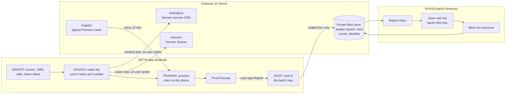

<div align="center">

# SATYA

**Check what a message asks for against what your bank has promised it will never ask for.**

An open-source shield against impersonation and deepfake fraud in Indian banking, built for the RAKSHAM AI Cybersecurity Hackathon (IIT Delhi), Problem Statement 03.

[](LICENSE)
[](android/)
[](android/)
[](web/)
[](https://docs.sarvam.ai)
[](CHANGELOG.md)

[Two verticals](#two-verticals) · [How it works](#how-it-works) · [Quick start](#quick-start) · [Testing](#testing) · [Privacy](#privacy-and-the-five-laws) · [Repository map](#repository-map)

</div>

---

## The problem

A scammer can fake a voice, a face, a logo or a sender name. What they cannot change is the request itself: *share your OTP*, *install AnyDesk*, *move your money to a safe account*, *pay a ₹10 KYC fee to this UPI ID*. Banks, the RBI, TRAI and NPCI have already written down that they never ask for these things.

SATYA turns those written statements into signed **Promise Cards** and checks every request against them, on the phone, before money moves. AI explains what it sees in plain English and Hindi; a deepfake score is a supporting signal, never the verdict.

## Two verticals

SATYA has two products, one for each side of a fraud.

| | **SATYA**, for people | **NYAYA**, for banks |
|---|---|---|
| Who | Anyone with an Android phone. No account, no login. | A bank's fraud desk. |
| Where | [`android/`](android/) | [`web/`](web/), live at **[satya-gateway.vercel.app/login](https://satya-gateway.vercel.app/login)** |
| What it does | Checks a screen, SMS, call, WhatsApp message or voice note against the bank's promises. Shows a Proof Receipt, and sends a sealed report to the bank. | Receives sealed reports and opens them in the browser with the bank's own key. Checks any forwarded message, and blocks a scammer for every SATYA phone. |
| Runs on | The phone. Rules work offline. | The Vercel gateway: private Blob storage and Sarvam AI. |

### SATYA (the app)

- **Circle to Check.** Freeze any screen and circle the message. Three ways to start, from any app:
  - triple-tap the edge strip;
  - tap the *Check screen* Quick Settings tile;
  - use Android's **accessibility button** or shortcut.
- **Proof Receipt.** The verdict (*Breaks promise*, *Looks like a scam*, *Keeps promise* or *Unknown*) shows:
  - the exact promise that was broken, with a link to its official source;
  - the kill-chain stage;
  - the herd count (how many phones saw the same UPI ID or number);
  - the **SATYA AI reading**: one plain sentence and what to do next.
  - Tap हिंदी to read the receipt in Hindi or hear it aloud.
- **Background guard.** New SMS and WhatsApp messages and incoming calls are checked against the rules on the phone. Nothing is uploaded.
- **Report to bank.** The report is sealed on the phone with the bank's public key. Only that bank can open it. The phone tracks its status: Delivered, then Opened, then Confirmed fake, then Blocked for everyone.
- **Know Your App.** Flags apps installed outside an app store that pose as a bank or KYC app. Suspect Watch blocks their PIN and OTP screens. *Ask SATYA AI* gives a second opinion.
- **Doctor.** Nineteen self-tests, including a 10-run reliability mode, so a demo phone can prove every feature works.

### NYAYA (the bank console)

Three features, each one end to end:

1. **Report Inbox.** Sealed reports from phones arrive within seconds.
   - The report is opened in the browser with the bank's Box key; the server never holds the key.
   - An optional **AI case brief** (Sarvam) summarises the case and recommends *block*, *investigate* or *dismiss*.
2. **Scam Check.** Paste a message or upload a voice note. NYAYA runs the same signed promise rules as the phone, and Sarvam explains the result in English and Hindi.
3. **Blocklist (One-Click Kill).** Block a UPI ID, number or website.
   - Every SATYA phone treats it as fake from its next sync.
   - Only fingerprints and masked labels ever reach the server.

## How it works



1. **Promises, signed.** [`spec/satya_bank_promises.json`](spec/satya_bank_promises.json) holds the promise rules for SBI, HDFC, ICICI, Axis and PNB, plus global RBI, TRAI and NPCI rules. Each one cites an official document in [`data/bank-rules/`](data/bank-rules/). The cards are signed with a root key pinned in the app, so a forged card is rejected.
2. **Rules decide.** The phone matches the request against the cards. *Breaks promise* comes only from a rule.
3. **AI explains.** For a check the user starts, the masked text goes to Sarvam through the gateway. The answer labels the ask, explains it, and can raise *Looks like a scam* when no promise matches but it is at least 75% sure. An AI label can never flag a message that came from the bank's official sender, number or link.
4. **Reports are sealed.** The scammer's values stay readable for the bank; the user's own details are masked. The whole report is encrypted with the bank's public key (libsodium sealed box) before it leaves the phone.

## Privacy and the five laws

1. Background checks never upload content. Only a user action can send text, images or audio off the phone.
2. One door out: every byte that leaves the phone goes through one audited client, and is listed in the in-app Privacy Log.
3. Rules run on the phone. The cloud labels, scores and counts; *Breaks promise* is never the cloud's call.
4. The cloud processes in memory and forgets. There are no phone-user accounts and no IP logs.
5. Only the bank can open a report: it is sealed to the bank's public key on the phone.

> **AI and privacy, stated plainly.** Since 0.3.0, the text you *choose* to check is sent, masked, to [Sarvam AI](https://www.sarvam.ai) through SATYA's gateway. This lets every check carry a plain-language explanation on any network. Your name and number are replaced on the phone first. The Sarvam API key lives only on the server; it is not in the app and not in this repository.

## Quick start

### Install the app

Install `SATYA.apk` on an Android 11+ phone and follow the in-app Setup. Signed APKs are shared directly by the maintainers and are not attached to [releases](https://github.com/workblue21/SATYA/releases), because each build carries the gateway's app key. You can also build your own (below). Samsung notes:
- Turn Auto Blocker off.
- Allow restricted settings before enabling Accessibility.
- The edge strip sits on the left, because One UI's Edge Panel uses the right.

### Build the app

Needs JDK 21 and the Android SDK (compileSdk 37).

```bash
cd android
cp secrets.properties.example secrets.properties   # gateway URL, app key, pinned public keys
./gradlew :app:assembleDebug                         # or :app:assembleRelease with keystore.properties
```

### Run the gateway and NYAYA locally

Needs Node 22.

```bash
cd web
cp .env.example .env.local     # Sarvam key, Blob token, console password and secret, SATYA keys
npm ci
npm run dev                    # http://localhost:3000/login
```

Deploy with `vercel deploy --prod` from `web/`. [`web/.env.example`](web/.env.example) lists every variable. Create the store with `vercel blob create-store <name> --access private`.

### Self-hosted AI (optional)

[`vivek/`](vivek/) is a FastAPI service with open models. It provides Qwen3-4B on llama.cpp, Whisper-small speech-to-text, and voice and face deepfake classifiers chosen by evaluation, and it runs on a laptop:

```bash
bash tools/local-cloud.sh --local       # VIVEK on 127.0.0.1:8000
adb reverse tcp:8000 tcp:8000           # phone uses it over USB; Doctor -> Override URLs
```

## Testing

| Suite | Command | Result (0.3.0) |
|---|---|---|
| Python oracles (the spec every language must match) | `python spec/reference/rules_ref.py spec/satya_bank_promises.json spec/rule_cases.json` | 17/17 rule cases, 10/10 masking, 3/3 Pay Check |
| Kotlin core + app | `cd android && ./gradlew :core:test :app:testDebugUnitTest` | 17 tests pass |
| One door out | `bash tools/check_one_door.sh` | 3/3 |
| Gateway + console | `cd web && npx vitest run` | 64 tests pass |
| Live end-to-end | `cd web && npx tsx --env-file=.env.local scripts/smoke.ts` | 15/15 against production |
| Sarvam labelling accuracy | `cd web && npx tsx --env-file=.env.local scripts/eval-sarvam.ts` | 18/20 tuning, 13/14 held out, median 0.8 s |
| On device | Settings → long-press the version line → Doctor → Run all | 19/19 on the Android 15 emulator |

Every phase gate, measurement and deviation from the specification is recorded in [`BUILD_LOG.md`](BUILD_LOG.md).

## Repository map

| Path | What |
|---|---|
| [`SATYA_ARCHITECTURE.md`](SATYA_ARCHITECTURE.md) | The build specification and single source of truth. Section 21 lists every deviation. |
| [`spec/`](spec/) | Promise Registry, shared test vectors, and Python reference implementations. |
| [`data/bank-rules/`](data/bank-rules/) | The official documents each promise cites. |
| [`android/`](android/) | SATYA app (`app/`), pure-Kotlin rules engine (`core/`), and a harmless fake-KYC demo app (`fakekyc/`). |
| [`web/`](web/) | NYAYA console and the gateway API (Next.js 16, Vercel). |
| [`vivek/`](vivek/) | Optional self-hosted AI and deepfake scoring (FastAPI). |
| [`ai-worker/`](ai-worker/), [`setu/`](setu/) | Optional Cloudflare Workers: an OpenAI-compatible AI endpoint, and a privacy relay that strips identifying headers. |
| [`supabase/`](supabase/) | Postgres schema with row-level security, for deployments that outgrow Blob storage. |
| [`design/`](design/) | The design handoff the apps are built from. |
| [`tools/`](tools/) | Secret guard (pre-commit), one-door check, local AI launcher. |

## Contributing and security

See [`CONTRIBUTING.md`](CONTRIBUTING.md) to get set up, and [`SECURITY.md`](SECURITY.md) to report a vulnerability privately. Everyone taking part is expected to follow the [Code of Conduct](CODE_OF_CONDUCT.md).

## Licence

Apache License 2.0, see [`LICENSE`](LICENSE).
- The fonts (Sora, Hanken Grotesk and Noto Sans Devanagari) are under the SIL Open Font License.
- The documents in `data/bank-rules/` belong to their publishers and are included for reference.
- SATYA is not affiliated with any bank, the RBI, NPCI or Sarvam AI.
