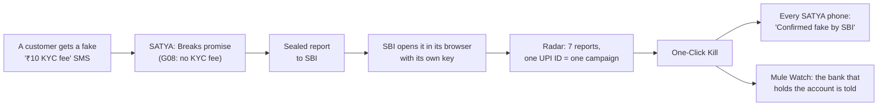

# How SATYA solves impersonation fraud

**RAKSHAM AI Cybersecurity Hackathon, IIT Delhi · Problem Statement 03: deepfake and impersonation fraud in financial communications**

This document explains the idea behind SATYA and how it stops a scam, step by step. For the list of what was built and how it was tested, see [`BUILD.md`](BUILD.md).

---

## 1. The problem

Indians lost **₹22,845.73 crore** to cyber fraud in 2024, across **36,37,288** reported financial-fraud incidents (MHA, Lok Sabha reply, July 2025). Most of it is social engineering. Nobody breaks into the bank. The customer is persuaded to do something themselves:

- "I am calling from SBI. Tell me the OTP you just received, or your card will be blocked."
- "Your KYC has expired. Pay a ₹10 fee to `sbi.kyc@ybl` to keep your YONO account."
- "Install AnyDesk so our engineer can fix your account."
- "Your money is at risk. Move it to this safe account."
- A video call or voice note from a "CFO" asking finance to release an urgent payment.

### Why today's defences miss it

| Defence | What it looks at | Why it is too late or too weak |
|---|---|---|
| Bank transaction monitoring | The payment | By the time money moves, the customer has already been persuaded. |
| Caller-ID apps | Who is calling | Numbers and sender names are easy to spoof or rent. |
| Deepfake detectors | The face or voice | An arms race. A better clone defeats yesterday's detector, and a plain phone call needs no deepfake at all. |
| Awareness campaigns | The customer's memory | Under pressure ("your account will be blocked in 10 minutes"), people forget. |

## 2. The insight: check the *ask*, not the face

A scammer can fake a voice, a face, a logo and a sender name. What they **cannot** change is what they need you to do. And for exactly those requests, banks and regulators have already written down a promise:

| What the scammer needs | The written promise | Who promised |
|---|---|---|
| Your OTP, PIN or password | "We never ask for your OTP, PIN or password." | RBI and every bank |
| A KYC fee or "verification charge" | No bank charges a fee by UPI to complete KYC | Banks |
| A KYC link by SMS or WhatsApp | SBI never sends a link to update KYC | SBI |
| Screen-sharing (AnyDesk, TeamViewer) | Banks never ask you to install a remote-access app | Banks, RBI |
| Money moved to a "safe account" | No bank asks you to move money to protect it | Banks, RBI |
| A service call from a personal mobile | Service and transaction calls come from the 1600 series | TRAI |
| A link outside the bank's domain | Bank links use `.bank.in` | RBI |

So SATYA does not try to prove *who* is talking. It checks **what is being asked** against **what the bank has promised it never asks**. If the request breaks a promise, it is a scam, however perfect the deepfake.

> **Transaction monitoring sees the payment. SATYA sees the persuasion, before the payment.**

## 3. How it works for a person (the SATYA app)

### Step 1: Promises become signed, machine-checkable rules

- We read the official documents and wrote each "never" as a rule with its source link. There are 7 documents from the RBI, TRAI, NPCI, SBI, ICICI, Axis and PNB, kept in [`data/bank-rules/`](data/bank-rules/).
- Today there are **12 rules**: 8 apply to every bank (G01–G08), and 4 are bank-specific (SBI, Axis, PNB).
- Each bank also has a list of its official channels: SMS headers, toll-free numbers, web domains and app packages.
- The rules are packed into **Promise Cards** and signed with SATYA's root key. The app has that key built in, so a forged or altered card is rejected.
- From version 0.4.0, a bank can publish its own card, signed with its own key.

### Step 2: The check runs on the phone

SATYA checks a message in four ways:

| How | When | What leaves the phone |
|---|---|---|
| **Circle to Check**: triple-tap the edge strip, tap the Quick Settings tile, or use Android's accessibility button, then circle the message | The user chooses | Nothing, until the user asks for the AI reading |
| **Share** a screenshot, text or voice note to SATYA | The user chooses | The same as above |
| **Background guard**: every new SMS, WhatsApp message and incoming call | Automatically | **Nothing.** Rules only, on the phone |
| **Know Your App**: every newly installed app | Automatically | Nothing (a 5-character fingerprint only if the user asks) |

The rules engine runs on the phone and works **offline**. The verdict comes back as a **Proof Receipt**:

| Verdict | Meaning | Decided by |
|---|---|---|
| **Breaks promise** | The request breaks a written promise. The receipt quotes the promise and links its official source. | Rules only |
| **Looks like a scam** | No promise covers it exactly, but SATYA AI is at least 75% sure it is a scam (for example, an electricity-bill disconnection SMS). | AI, never over a bank's official channel |
| **Keeps promise** | It came from the bank's official sender, number or link. The receipt adds: "This does not prove it is safe." | Rules |
| **Unknown** | Nothing matched | — |

The receipt also shows:
- the **kill-chain stage** (Contact → Ask → OTP → Drain), so the user knows how close they are to losing money;
- the **herd count**: how many SATYA phones saw the same UPI ID or number this week;
- **what to do next**, including "Call 1930 within the first hour" if money was lost.

It can be switched to Hindi and read aloud.

### Step 3: AI explains; rules decide

For a check the user starts, the text is first **masked on the phone**: the user's own name, number and account are replaced with tokens such as `[NAME]` and `[PHONE_1]`. It is then sent to **Sarvam AI** (`sarvam-105b`) through SATYA's gateway. Sarvam returns:
- what the message is asking for (OTP, fee, remote access, safe account, link, call-back…);
- which bank it claims to be;
- one plain sentence explaining it, in **English and Hindi**, and what to do.

Two guards keep the AI honest:
1. An AI label becomes a warning only if the message actually contains a word for that ask. "Pin code" for a delivery is not a PIN.
2. A message from the bank's official channel is never turned into a warning by the AI, so a genuine OTP SMS or debit alert stays clean.

On SATYA's labelled set (34 English, Hindi and Hinglish messages), Sarvam labels **31 of 34** correctly, in a median of **0.8 seconds**.

### Step 4: Report it to the bank, sealed

One tap sends a report to the bank the scam pretended to be (or any bank the user picks).
- The report is **encrypted on the phone with that bank's public key** (libsodium sealed box). SATYA's servers carry a box they cannot open.
- The scammer's UPI ID, number and link stay readable for the bank; the user's own details are masked.
- The user can choose to include their number for a callback; it is off by default.
- The phone follows the report: Sealed → Delivered → Bank opened → Confirmed fake → Blocked for everyone.

## 4. How it closes the loop with institutions (NYAYA)

One person's report becomes protection for everyone, through **NYAYA**, the console for bank fraud desks and company finance teams.

| What the institution needs | How NYAYA solves it |
|---|---|
| Learn about a campaign before the losses pile up | **Impersonation Radar** groups reports by the scammer's UPI ID, number, site or app. The desk acts once per campaign, not once per complaint. |
| See the evidence, legally and privately | **Case Review** opens the sealed report in the bank's browser. It shows the message, the broken promise with its source, and the scammer's values. An optional AI case brief recommends block, investigate or dismiss. |
| Stop the scammer reaching anyone else | **One-Click Kill** sends a block that reaches every SATYA phone at its next sync, for every bank's customers. |
| Freeze the mule account before the next victim pays | **Mule Watch** routes each confirmed fake account to the bank that holds it, by UPI handle or IFSC. That bank can match its own accounts privately, in the browser. |
| Stop genuine campaigns being flagged | The **Promise Card Builder** lets the bank declare its own official channels, signed with its key, with a preview of what changes on phones. |
| Answer "Is this message really from you?" | **Scam Check** gives contact-centre agents the same verdict and the words to say back. The **Scam Check API** brings it into the bank's app, IVR and chatbot. |
| Stop a deepfake "CFO" payment at a company | **Pay Check** tests the request against the company's own rules: known vendors, approvers, limits and channels. It also checks accounts banks have confirmed as fake. A held payment needs **Verify Before Release**, a recorded callback to the saved number, which a cloned voice cannot answer. Every decision is signed and exported as an Evidence PDF. |
| Prove it worked, and who did what | The **Fraud Overview** shows reports, time to act, values blocked, customers warned and loss avoided (with the assumption shown on screen). A **named audit trail** records every action. |

The full business case is in [`docs/INSTITUTIONS.md`](docs/INSTITUTIONS.md). It covers who pays, pricing hypotheses and a seven-minute demo.

## 5. One scam, start to finish

1. Ramesh gets an SMS from `+91 70448 21319`: *"Your YONO account will be blocked today. Pay ₹10 KYC fee to sbi.kyc@ybl."*
2. SATYA's background guard checks it on the phone, uploading nothing. It breaks **G08** (no KYC fee) and **G05** (banks send SMS from a registered header, not a mobile number). A banner warns Ramesh.
3. Ramesh opens the Proof Receipt. Verdict: **Breaks promise**. The kill-chain stage is *Ask*. SATYA AI explains in Hindi: *"यह संदेश KYC के नाम पर UPI से फ़ीस माँग रहा है। बैंक ऐसा कभी नहीं करते।"* ("This message asks for a fee by UPI in the name of KYC. Banks never do this.")
4. He taps **Report to SBI**. The report is sealed on his phone and delivered in about 3 seconds, with a receipt signed by SATYA and verified on his phone.
5. SBI's fraud desk sees 7 reports with the same UPI ID on the Radar. It opens one, confirms it is fake, and clicks **Block for everyone**.
6. All 7 reports close. Ramesh's phone shows "Confirmed fake by SBI". Every other SATYA phone now flags `sbi.kyc@ybl` on sight. The bank that holds that UPI handle sees it in Mule Watch.

## 6. Privacy by design: the five laws

1. **Background checks never upload content.** Only a user action can send text, images or audio off the phone.
2. **One door out.** Every byte that leaves the phone goes through one audited client, and the in-app Privacy Log lists each one in plain words.
3. **Rules decide on the phone.** The cloud labels, explains and counts; *Breaks promise* is never the cloud's call.
4. **The cloud forgets.** There are no accounts for phone users and no IP logs. AI requests are processed in memory and not stored.
5. **Only the bank can open a report.** Reports are sealed to the bank's public key on the phone.

Herd counts use **k-anonymity**: the phone sends only the first 5 characters of a fingerprint and picks its own match from the answers. The server never learns which UPI ID the user saw.

## 7. Why this approach holds up

- **It does not need to win the deepfake arms race.** A perfect clone still has to ask for the OTP, the fee or the transfer, and that ask breaks a promise.
- **It explains itself.** Every *Breaks promise* points to a written, sourced promise. A customer, a bank, a regulator or a court can follow it.
- **It works where the customer is.** The verdict comes on the phone, at the moment of persuasion, offline if needed, in English or Hindi.
- **It gets stronger with every bank.** One bank's block protects every bank's customers, and mule accounts are routed to the bank that holds them. No single bank can build this alone.
- **It is private enough to deploy.** Sealed reports, masked text, prefix lookups and browser-side keys are easier to defend under India's DPDP Act than a system that collects content.

## 8. Honest limits, and what comes next

- **Promise coverage.** There are 12 rules for 5 banks today. A scam that asks for something no bank has promised against gets *Looks like a scam* from the AI, or *Unknown*. Every bank that publishes a Promise Card widens the coverage.
- **AI privacy trade-off.** For checks the user starts, masked text goes to Sarvam. Background checks never do.
- **Deepfake scores** (voice and face) come from a self-hosted service ([`vivek/`](vivek/)) that is not hosted publicly yet. They are a supporting signal and never decide the verdict.
- **Scale.** The gateway stores data in a private Vercel Blob store today. The Postgres schema with row-level security ([`supabase/`](supabase/)) is the path to bank scale, with SSO and maker-checker approval for blocks.
- **Next:** bank advisories pushed with the registry, I4C and Digital Payment Intelligence Platform feeds, and a pilot with one bank's fraud desk and one corporate-banking client.
